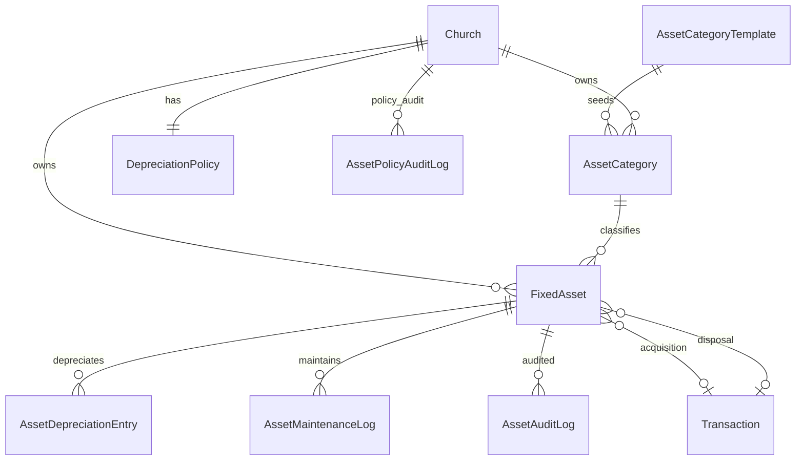
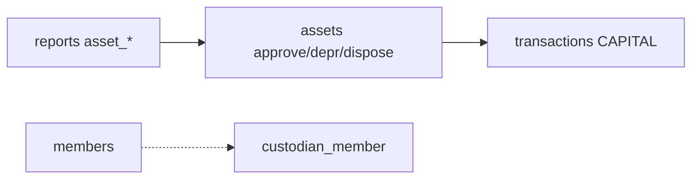

# Assets Module Specification

**App:** `assets` (`AssetsConfig`)  
**Mount:** `/assets/`  
**Companions:** `../TRANSACTIONS/transactions_spec.md`, `../FINANCE/finance_spec.md`, `AGENTS.md` §3  
**Source of truth:** Live Django code

| Label | Meaning |
|-------|---------|
| **Current** | Implemented |
| **Planned (AGENTS.md)** | Constitution aspirations |
| **Recommended** | Future improvements |

---

## 1. Purpose and responsibilities

Fixed-asset register with categories (GRA-aligned templates), depreciation policy, approval workflow, capitalization/depreciation/disposal journals (CAPITAL), maintenance log, hierarchy rollup, activity audit.

| Owns | Does not own |
|------|----------------|
| AssetCategoryTemplate / AssetCategory | Inventory stock (not implemented) |
| DepreciationPolicy | Generic CoA |
| FixedAsset lifecycle | Petty cash / procurement |
| Depreciation entries + maintenance | Remittance |

---

## 2. Models and relationships



### Enumerations
- Status: DRAFT / PENDING_APPROVAL / ACTIVE / UNDER_REPAIR / DISPOSED / REJECTED  
- Methods: STRAIGHT_LINE / DECLINING_BALANCE  
- GRA classes 1–4 on templates/categories/assets  

### FixedAsset (selected fields)
`asset_code`, name, cost, salvage, useful life, method, custodian member/name, insurance/warranty, supplier/invoice, approval/disposal fields, NBV tracking via depreciation entries, optional GL transaction links as implemented.

**AssetDepreciationEntry (Current, Phase 1 / 1A / 1B):** unique `(asset, period_year, period_month)`; optional `transaction`; `workflow_status` (`AWAITING_APPROVAL` / `POSTED` / `REJECTED` / `FAILED` / `RECOVERY_REQUIRED`, default `POSTED`); `register_applied` (default `True`); nullable `initiated_by`; nullable `posted_at`. Migration `0007` reclassifies **only via the existing journal FK**: PENDING → unapplied awaiting; REJECTED → unapplied rejected; voided/REVERSED → `RECOVERY_REQUIRED` still applied (void does not unwind NBV); APPROVED non-voided and null-transaction rows are left as posted/applied. Register totals use `register_applied=True` and exclude PENDING/REJECTED-linked journals. APPROVED journals are not proof that stored NBV was finalized. **Phase 1B:** `_finalize_depreciation_register` and `post_depreciation_entry` fail closed (no journal create/approve, no period row, stored accum unchanged) when contributing totals disagree with stored accum, or when FK-linked `RECOVERY_REQUIRED` / `FAILED` / voided / REVERSED rows exist. Null-FK legacy rows stay contributing; they block only when the sums disagree.

**Managers:** none custom. RBAC helpers in `assets/rbac.py`.

**Current layering (Phase 2 / P1-2 Assets slice):**

```
Views → Services → Selectors → Repositories → Models
```

| Layer | File | Role |
|-------|------|------|
| Selectors | `assets/selectors.py` | Church-scoped reads (assets, categories, depreciation entries, audit/activity, rollups) |
| Repositories | `assets/repositories.py` | Persistence writes (audit, policy, templates/categories, asset/depreciation/maintenance) |
| Services | `assets/services.py` | Lifecycle, depreciation calc, capitalization/disposal journals via `transactions.repositories` + `_post_line` |

Views no longer call asset model managers / `get_object_or_404` on domain models directly for list/detail paths.

---

## 3. Business rules (Current)

1. Draft → submit → approve/reject; approve may capitalize (`capitalize_on_approval`).  
2. Segregation of duties: submitter cannot approve (assert helpers).  
3. Monthly depreciation: calculate → post DEPRECIATION_EXPENSE / ACCUMULATED_DEPRECIATION via transactions when policy allows. **Phase 1D:** the persisted checker is the authenticated actor (`request.user` on HTTP). The run form does not collect a checker identity. Background Celery/management-command callers prepare a PENDING journal plus an unapplied `AssetDepreciationEntry` FK and must not approve. `user=None` still creates nothing. Maker/self HTTP runs also leave the journal PENDING. An eligible other user re-runs `post_depreciation_entry(..., allow_approval=True)`; `_commit_journal_approval` requires that FK link and `resolve_authorized_journal_checker(trx, user) is user`. Approval, register finalization, workflow flags, and stored accum share one atomic block. Description-matched unlinked PENDING journals are refused (no recover, no duplicate), not treated as identity. **Phase 1C / 1I:** `approve_transaction` / HTTP pending queue / admin bulk approve refuse journals linked by `AssetDepreciationEntry.transaction` **and** refuse unlinked PENDING CAPITAL (source module cannot be established from FKs). **Phase 1J:** `approve_module_journal` refuses the same depreciation FK and refuses unlinked CAPITAL. Acquisition/disposal set the asset journal FK first, then call `approve_module_journal`; a failed checker still rolls back inside the atomic post. `_commit_journal_approval` is not a generic queue path. Django admin: `accumulated_depreciation`, `acquisition_transaction`, `disposal_transaction`, entry `workflow_status`, and `register_applied` are read-only (does not block ORM/SQL). **Phase 1K:** admin POST cannot set the acquisition/disposal journal FKs. `approve_module_journal` still requires a same-church asset FK; that does not prove the journal was created by those posting services. Migration `0007` classification is frozen inside the migration file (not the live helper). `0006` POSTED/`register_applied=True` defaults are not historical proof. Register rewrite remains fail-closed when historical application is unresolved (Phase 1B). Acquisition still uses `approve_module_journal` with the asset approver after the acquisition FK is set; a failed checker rolls back inside that atomic post. Disposal prepares a linked CAPITAL journal and leaves the asset ACTIVE until an authorized checker other than the disposer posts it (`checker=` or the authenticated HTTP actor). Generic `approve_transaction` still refuses that CAPITAL row.
4. Dispose writes off NBV when `post_disposal_to_ledger`. HTTP dispose does not collect a checker identity; the signed-in user is the only candidate. A first submit by the disposer leaves a PENDING journal; a second submit by an eligible checker posts it and marks DISPOSED.  
5. Church-scoped categories unique by code; templates are platform-wide.  
6. Feature flag: `assets`.  
7. Commands: `setup_assets`, `run_asset_depreciation`, **Phase 1F–1H** `inventory_depreciation_register` (read-only; requires `--church CODE|UUID` or explicit `--all-churches`; does not enforce RBAC). Church codes are unique per district; an ambiguous code fails closed (pass the church UUID). FK-based categories only. Unlinked CAPITAL journals are split into disjoint PENDING, APPROVED, and other (`REJECTED` / `REVERSED` / voided) candidate lists; none are confirmed depreciation; listing other statuses does not make a row recoverable. `--limit` truncates printed identifiers only; `count` is the full population; entry `ids` and `records` share one ordered evaluation. Unfamiliar `workflow_status` values stay in `unexpected_workflow_entries`. Does not post/approve/void or write NBV. Output contains tenant identifiers and totals.

---

## 4. Services (Current)

`assets/services.py`: seed templates/categories/policy; code generation; submit/approve/reject; post acquisition/depreciation/disposal; run/preview monthly depreciation; register CSV; hierarchy rollup; activity logs; KPIs; report builders for reports app.

---

## 5. Permissions (Current)

Registry: `view_assets`, `manage_assets`, `approve_assets`, `dispose_assets`, `manage_asset_policy`, `export_assets`.

`assets.rbac.user_may_view_assets` grants read access when the user has `view_assets` (or manage/approve/policy). Index, asset list, and detail use this helper; create/edit/export remain manage-gated.

---

## 6. URL structure (Current)

`/assets/` (`app_name=assets`):

| Path | Name |
|------|------|
| `` | `index` |
| `assets/`, `new/`, `<uuid>/`, edit, submit, approve, reject, dispose, maintenance | register lifecycle |
| `assets/export.csv` | export |
| `policy/`, `categories/…` | policy & categories |
| `depreciation/run/` | run depreciation |
| `activity/`, `activity/export.csv` | audit |
| `hierarchy/` | rollup |

---

## 7. Forms / Views / Templates

**Forms:** `FixedAssetForm`, `RejectAssetForm`, `DepreciationPolicyForm`, `AssetCategoryForm`, `MaintenanceLogForm`, `RunDepreciationForm`.

**Views:** `_assets_access` / `_policy_access` / `_assets_read_access`.

**Templates:** `templates/assets/`.

---

## 8. Signals

**None** dedicated. Defaults via `ensure_asset_defaults_for_church` / management commands / migration seed templates.

---

## 9. Middleware dependencies

Auth, CSRF, church/denomination scope, `require_feature("assets")`, platform maintenance/login limits.

---

## 10. Cross-module interactions



---

## 11. Financial implications

- Acquisition: FIXED_ASSET vs CASH/BANK (per policy).  
- Depreciation: expense vs accumulated depreciation.  
- Disposal: write-off NBV.  
- All must balance; respect working day/period when txn services assert.

---

## 12. Security considerations

- SoD on approve.  
- Hierarchy rollup scoped by user manageable churches.  
- Export gated by `export_assets`.  
- Audit logs read-oriented in admin.

---

## 13. Known architectural gaps

- No inventory submodule (AGENTS inventory is planned).  
- Units-of-production depreciation not implemented.  
- Soft-delete absent (status DISPOSED/REJECTED).  
- No Church `post_save` auto-seed (use `setup_assets` / `ensure_asset_defaults_for_church`).  
- Django admin for church-owned asset models is denomination-scoped via `admin_custom.tenancy` (OWNER global; others `managed_denominations`). Audit logs remain read-only.  
- No REST API.

---

## 14. Planned vs Recommended

| Topic | Current | Planned | Recommended |
|-------|---------|---------|-------------|
| Lifecycle | Approve/capitalize/depr/dispose | Full AGENTS asset lifecycle | Keep GL posts via transactions |
| Methods | SL + declining balance | + units of production | Add only with tests |
| Inventory | Absent | Stock movements | Separate app if needed |

**Must not change:** SoD on approve; balanced capitalization/depreciation/disposal; church isolation.
